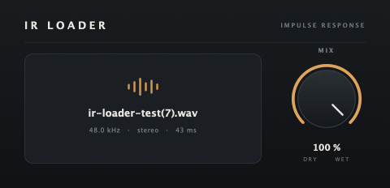

**Simple IR VST** — a minimal impulse response loader: one file picker, one mix knob.

## Downloads

- **macOS (Universal: Apple Silicon + Intel)** — `Simple-IR-VST-<version>-macOS-universal.zip`
- **Windows (x64)** — `Simple-IR-VST-<version>-Windows-x64.zip`

## macOS install

1. Download the macOS zip and unzip it.
2. Double-click **Install.command**. If macOS blocks it (the build is ad-hoc signed, not notarized), right-click the file and choose **Open**.
3. Restart your DAW and rescan plugins.

Installs to `~/Library/Audio/Plug-Ins/VST3/IR Loader.vst3` and `~/Library/Audio/Plug-Ins/Components/IR Loader.component`. A standalone app is included.

If the installer is blocked, clear the quarantine flag on the unzipped folder first:

    xattr -dr com.apple.quarantine "/path/to/Simple IR VST <version>"

## Windows install (64-bit)

1. Download the Windows zip and unzip it.
2. Right-click **Install.ps1** → **Run with PowerShell**. If script execution is blocked, run:

       powershell -ExecutionPolicy Bypass -File .\Install.ps1

   This installs to `%LOCALAPPDATA%\Programs\Common\VST3`.
3. For an all-users install, run the same command with `-System` from an administrator PowerShell (installs to `C:\Program Files\Common Files\VST3`).

The zip also contains the standalone `IR Loader.exe`.

## Features

- Load WAV / AIFF / FLAC impulse responses by clicking the panel or dragging a file onto the plugin
- One **Mix** knob, 0–100% (dry → fully convolved)
- Zero-latency convolution, mono and stereo IRs, automatic sample-rate conversion
- IR path is saved with your session and restored on reopen
- No IR loaded = transparent pass-through
- VST3, AU (macOS) and standalone builds

## Notes

- IRs are energy-normalised for consistent levels; there is intentionally no output gain control.
- Only the IR file path is stored in session state, not the audio data.
- macOS binaries are ad-hoc signed but not notarized; Windows binaries are not code-signed.
- Source code: https://github.com/leocb/Simple-IR-VST (AGPL-3.0)
