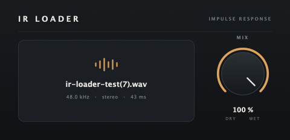

# Simple IR VST

A minimal impulse response loader: pick an IR audio file from disk, blend it in
with one knob. VST3, AU and standalone builds for macOS.



## Download & install

Grab the latest macOS build from the
[**Releases page**](https://github.com/leocb/Simple-IR-VST/releases/latest):

1. Download `Simple-IR-VST-<version>-macOS-universal.zip` and unzip it.
2. Double-click **Install.command**.
   If macOS blocks it as an unidentified developer, right-click the file and
   choose **Open**.
3. Restart your DAW and rescan plugins if needed.

The installer copies:

- `~/Library/Audio/Plug-Ins/VST3/IR Loader.vst3`
- `~/Library/Audio/Plug-Ins/Components/IR Loader.component` (AU)

The standalone app (`IR Loader.app`) is in the zip; drag it to `/Applications`
if you want to keep it. To install manually, drag the two plugin bundles into
those folders and clear the download quarantine flag:

```sh
xattr -dr com.apple.quarantine ~/Library/Audio/Plug-Ins/VST3/"IR Loader.vst3"
xattr -dr com.apple.quarantine ~/Library/Audio/Plug-Ins/Components/"IR Loader.component"
```

Requires macOS 11 or newer. The build is Universal (Apple Silicon and Intel),
ad-hoc signed but not notarized.

## Features

- **Load an IR from a file** — click the panel or drag a `.wav`, `.aif`, `.aiff`
  or `.flac` file onto it. Mono and stereo IRs work; IRs are resampled to the
  host sample rate automatically.
- **Mix knob (0–100%)** — 0% passes the dry input, 100% is fully convolved.
- **Zero latency** convolution (`juce::dsp::Convolution`).
- **Session recall** — the loaded IR path is saved with the plugin state and
  reloaded when the session opens.
- **Transparent when empty** — before an IR is loaded the plugin passes audio
  through untouched.
- **IR file info** — sample rate, channel format and length are shown under the
  file name.

## Build

Requirements: macOS 11+, CMake 3.22+, Xcode command line tools.

```sh
cmake -S . -B build -G Ninja -DCMAKE_BUILD_TYPE=Release
cmake --build build --parallel
```

JUCE 9 is expected in `third_party/JUCE`. If the folder is missing, CMake
downloads it automatically during configure.

Builds are native-architecture by default. For a universal binary:

```sh
cmake -S . -B build-universal -G Ninja -DCMAKE_BUILD_TYPE=Release \
      -DCMAKE_OSX_ARCHITECTURES="arm64;x86_64" -DIRLOADER_BUILD_TESTS=OFF
cmake --build build-universal --parallel
```

### Outputs

`COPY_PLUGIN_AFTER_BUILD` is enabled, so a normal build installs:

- `~/Library/Audio/Plug-Ins/VST3/IR Loader.vst3`
- `~/Library/Audio/Plug-Ins/Components/IR Loader.component` (AU)

The standalone app is left in
`build/IRLoader_artefacts/Release/Standalone/IR Loader.app`.

### Release package

```sh
scripts/package-release.sh 1.0.0
```

This builds a zip in `dist/` from the universal artifacts, including the
installer and a short readme. Attach it to a GitHub release.

## Tests

The test binary drives the processor offline and does not need a DAW:

```sh
cmake --build build --target IRLoaderTests
./build/IRLoaderTests
```

It checks that the plugin is transparent without an IR, that 0/50/100% mix
produce the expected dry/wet results, hot-swapping an IR while audio runs,
state save/restore, and error handling for missing/invalid files. To render the
editor previews used in `docs/`:

```sh
./build/IRLoaderTests --render-ui /tmp/ir-loader-preview
```

The built VST3 and AU also pass `pluginval --strictness-level 10` (including
editor and automation tests) and `auval`.

## Notes

- Impulse responses are normalised by JUCE's energy-based normalisation, which
  keeps levels consistent between different IRs and leaves headroom. If an IR
  sounds quiet, raise the level after the plugin; there is deliberately no
  output gain control.
- Only the IR file path is stored in the plugin state, not the audio data. If
  the file is moved or deleted, the plugin falls back to pass-through until an
  IR is loaded again.
- The mix is smoothed over 20 ms to avoid zipper noise when automating it.

## Project layout

```
CMakeLists.txt              build + plugin targets
Source/PluginProcessor.*    convolution engine, mix parameter, state
Source/PluginEditor.*       file panel, drag & drop, mix knob UI
Tests/ProcessorTests.cpp    offline DSP/state tests and UI snapshot renderer
Packaging/                  user-facing installer + readme for releases
scripts/package-release.sh  builds the release zip
third_party/JUCE/           JUCE framework (downloaded, not tracked)
```

## Licence

AGPL-3.0 — see [LICENSE](LICENSE). JUCE 9 is used under its AGPLv3 option. If
you have a commercial JUCE licence you can relicense this project accordingly.
